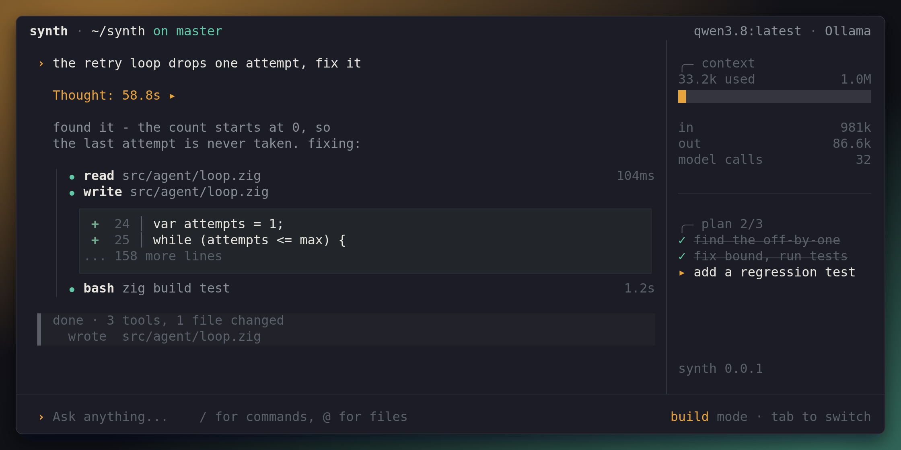

# synth



A terminal coding agent, written in Zig. Runs on local or hosted models, with
MCP servers and skills.

> Early. It works and it is used daily, but there is no stable release yet and
> things move.

## Install with Homebrew

```sh
brew tap aw1875/synth https://github.com/aw1875/synth.git
brew install aw1875/synth/synth
```

The tap lives in this repository. The explicit Git URL is required because its
name does not start with `homebrew-`. The formula downloads the published binary
for macOS arm64 or Linux x86-64; Zig is not required. It currently tracks the
rolling [`dev` prerelease](https://github.com/aw1875/synth/releases/tag/dev),
and the release workflows update its version, URLs, and checksums after publishing.
A model server with tool-call support is still required.

To update to the latest published build:

```sh
brew update
brew upgrade aw1875/synth/synth
```

## Build from source

### Requirements

- Zig 0.16
- A model server: [ollama](https://ollama.com), or anything speaking the OpenAI
  chat API. The model has to support tool calls.

### Build

```sh
zig build              # build synth
zig build run          # build and launch the TUI
zig build test         # the test suite, offline and network-free, ~10s
zig build release      # macOS arm64 and Linux x86-64/arm64 into zig-out/<triple>
```

The musl build is static and runs anywhere. There is nothing to install: the
binary is self-contained apart from the model server it talks to.

## First run

Start it in a project:

```sh
synth
```

With no provider connected it opens the provider picker. Pick one, give it a URL
and an API key if it needs one, and the key is stored for next time. `ctrl+p`
reopens that picker later, `ctrl+o` switches models across every connected
provider.

## Docs

- [Using synth](docs/usage.md): keys, searching, modes, approvals, rewind
- [Configuration](docs/configuration.md): the three files, every `config.json`
  key, environment overrides, pruning
- [CLI](docs/cli.md): subcommands and flags, ACP, remote sessions over ssh
- [MCP](docs/mcp.md): servers in `config.json`, auth, `/mcp`
- [Hooks](docs/hooks.md): running commands on lifecycle events, with examples
- [Skills](docs/skills.md): writing and finding them

Working on the code? Read [the contributing guide](docs/contributing.md)
and [AGENTS.md](AGENTS.md) first.

## Layout

```
src/
  core/       config, auth, sqlite, sessions, @path mentions, search primitives
  provider/   the ollama and OpenAI backends, and what fits in a context window
  agent/      the turn state machine: ask -> approve -> run -> repeat
  acp/        the ACP agent, and synth's own extension to it
  tools/      read, list, glob, grep, write, edit, bash, task, ask_user, skill, todo
  tui/        the vxfw widget tree: transcript, composer, pickers, sidebar
packages/
  mcp/        the MCP client, its own package, importing nothing from synth
```

`zig build test` runs the whole tree, `zig build test-mcp` the client alone -
which is also what proves it depends on nothing here.
